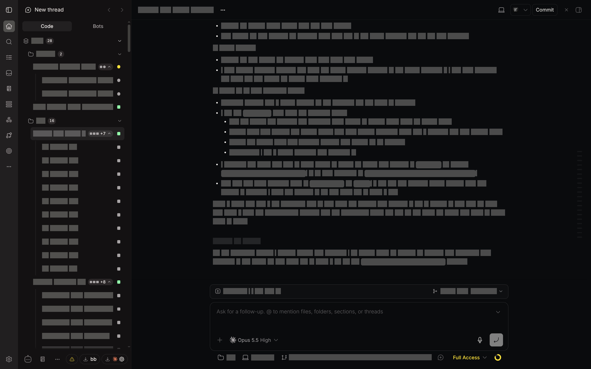

# Demo Mode



Demo Mode gives BB a quiet presentation state. Activate **Demo Mode** with the eye button in the sidebar footer, or press `Mod+Shift+D` (Command on macOS, Control elsewhere). The shortcut is the BB command `plugin:demo-mode/toggle`; rebind it in Settings → Keyboard or with `bb settings keyboard set plugin:demo-mode/toggle <shortcut>`. Each word of a thread or project name, the thread header, a message, a tool step, the "Working" status line, a running command, the uncommitted-files banner, or a draft becomes a solid block of the same length. The blocks are CSS highlights painted over the real text, so the layout does not move when the mode changes. Images keep their size and show a plain fill. Project, branch, and machine names in the composer footer are masked the same way, while the AI model and fallback remain visible. Sidebar rows, project and subagent structure, activity counts, and status indicators remain in place.

Plugin pages are covered too, while the BB frame stays visible, unless the plugin marks its own sensitive parts (see below). Demo Mode has no settings. It does not install or control other plugins.

The toggle is stored in this browser. It survives reloads and sync between tabs in the same browser profile. Turn the footer action off to restore normal rendering.

Demo Mode hides rendered content for presentations. It does not remove source data from the page, prevent access through developer tools, or replace access control. Review the visible screen before sharing it, especially after BB or plugin UI updates.

## For plugin authors

A plugin can keep its page readable in Demo Mode. It marks what is sensitive with two HTML attributes. It does not import or detect Demo Mode, and the attributes do nothing when Demo Mode is not installed.

- `data-bb-demo-ready` on the page root. It tells Demo Mode that this page marks its own sensitive parts, so the page is not covered.
- `data-bb-demo-sensitive` on each element that holds private text or images. Each word inside becomes a block, images get a plain fill, and `title` or `aria-label` values inside become "Demo item".

```tsx
<div data-bb-demo-ready>
  <h2>Telegram</h2>
  <article>
    <b data-bb-demo-sensitive>{message.sender}</b>
    <p data-bb-demo-sensitive>{message.text}</p>
    <button aria-label="Reply">…</button>
  </article>
</div>
```

Mark people, messages, project and task names, and free text. Leave column headers, tabs, buttons, counts, and statuses unmarked. Once a page has `data-bb-demo-ready`, any text without the sensitive marker stays visible, so mark new fields when you add them. Pages without `data-bb-demo-ready` stay fully covered.

## Development

Run `npm ci`, `npm run typecheck`, `npm test`, and `npm run build` from this directory. The plugin has no server-side behavior or external service. It uses a frontend content script and the CSS Custom Highlight API, which current Chromium, Safari, and Firefox support.
